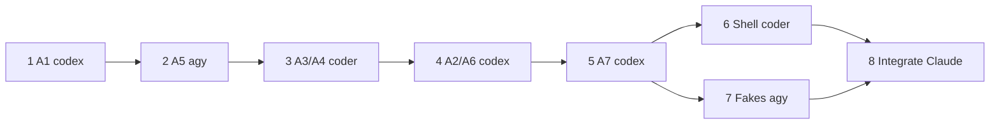

# Plan: Grounded answers and a searchable, nameable transcript (phase A)

This plan implements the approved spec, phase A (intent outcomes 1–5). Work
happens on branch `feat/60-grounded-answers-transcript` in
`/mnt/code/Source-home/GitHub/mixarchy-meetingai` and ships as one PR.

Line numbers are from `origin/main` at `7783739` and will drift as steps
land. Find code by the function names given.

## Decisions carried over from the approved spec

- **Line identity.** A line is identified by `meeting_lines.id` (UUID). The
  rowid (`line`) remains the paging cursor of `transcript.get` and nothing
  else.
- **Suggestions.** A suggestion is emitted only while `g.turn == turn`, and
  the event carries `turn`. `now.get` returns `turn`. Client and MCP both
  check it.
- **Notes in the prompt.** A live meeting's rolling-note chunks go before
  the transcript, labelled `[Nk] (m:ss–m:ss)`, oldest first. If they exceed
  `NOTES_BUDGET = 6_000` characters, the newest are kept. Restored meetings
  get no notes block.
- **Citations.** Transcript lines in the prompt are labelled `[k]`
  (k = 1..≤20). The model cites `[k]` or `[Nk]`. Sources are fixed at send
  time in `g.cite: Vec<Source>`, where `Source` is
  `{kind: line|notes, id, t0, t1, speaker, snippet≤160}`. A notes source's
  `id` is the first line with `start_time >= chunk.t0`.
  - **Parsing:** `\[(N?)(\d{1,2})\]`. Only labels that were offered count;
    duplicates are dropped and first-use order is kept. The result goes to
    `g.answer_sources` and `answer.sources {turn, sources}`.
  - **Clearing:** `g.cite` and `g.answer_sources` are cleared in
    `begin_send`, `interrupt` and `reset_session`.
  - **Not persisted** in phase A.
- **Hiding markers.** `answer.started` carries `cite_max` and `cite_notes`.
  The UI strips in-range ` [k]` / ` [Nk]` markers outside back-tick code. It
  shows **Based on** chips (`12:04 · Speaker 2`, or `Notes · 10:00–15:12`)
  that jump to the line. If the answer had meeting context but cites
  nothing, it shows "No meeting lines cited".
- **Search.** `transcript.search {query, meeting?, limit?}` matches with
  `instr(lower(text), lower(?))`, ordered by meeting `started_at` DESC then
  `start_time`. Limit 20 by default, 50 at most; queries need at least 2
  characters. Rows are `{meeting, title, started_at, id, who, speaker, text,
  t0}`.
- **Jumping.** `transcript.get {around: id}` takes the line's own meeting
  (an error if a different `meeting` is passed) and returns up to `limit/2`
  rows at or before the line and up to `limit/2` after it, by rowid.
- **Renaming.** `speakers.rename {meeting?, key, name}`, where `key` is the
  speaker number as a string or `"them"`. An empty name deletes. It emits
  `speakers.renamed`, and is user-only.
- **One resolver.** `meetings::label(names, who, speaker)` is used by
  `format_lines`, `transcript_excerpt`, `Self::who` (partial, final, get,
  restore, search), export and the prompt. `Inner.speaker_names` caches the
  names: loaded at `record_start` and `session_restore`, updated on rename,
  cleared in `reset_session`.
- **Out-of-date notes.** A nullable `meeting_speakers.updated_at TEXT` is
  added in both `schema.sql` and a guarded `ALTER`. A rename sets
  `strftime('%Y-%m-%d %H:%M:%f','now')`. `notes.get.stale` is true when the
  newest rename is at or after the recap's `updated_at` (or, with no recap,
  the newest chunk's `created_at`), compared as strings. Regenerating is
  manual.
- **Earlier answers.** Their text is kept. Chips keep the label from the
  time of the answer. After a rename, answers written earlier in the current
  view show "Speaker names changed after this answer".
- **MCP.** `transcript.search` is allowed, and filtered in the daemon via
  `for_agent` (as `session.list` does). The local-only guard resolves the
  meeting of an `around` line. `now.get` gains `turn`, `cite_max` and
  `sources`. `speakers.rename` is not allowed. #62 (restore guard) is out of
  scope.

## How it runs



- Steps 1–5 all edit `src/daemon/session.rs`, so they run **one after
  another** on this branch: each implementer starts from the commit of the
  step before.
- Steps 6 and 7 touch disjoint files (`shell/*.qml` and `shell/tests/*`), so
  they run in parallel.
- Implementers come in through the `handoff` skill (agy, Codex) or the
  `coder` agent. **They do not commit.** After each step, Claude:
  1. reviews the diff against the step;
  2. runs the step check;
  3. fixes small problems or sends the step back once;
  4. commits as `feat(<area>): <what> (#60, plan step N)`.
  A deviation is recorded in this plan in the same commit.
- If a handoff fails or a provider is out of quota, its error is reported
  verbatim, and the step falls back to `coder`. The PR notes the fallback.
- **Ownership.** Claude decides and integrates: every disagreement between
  implementers, reviewers and this plan is settled by Claude against the
  approved spec, and the decision is written in the commit message.

## Steps

Every step is **test first**: write the test, show it fails on the code
before the change, then implement. The step check, unless the step says
otherwise, is:

```bash
TMPDIR=/tmp devenv shell -- bash -c 'cargo fmt --check; cargo clippy --workspace --all-targets -q -- -D warnings; cargo test --workspace -q'
```

Traps for every step:
- Agents and MCP must stay refused `voice.*`, `providers.*`,
  `meetings.export` and every command not on the allowlist.
- Local-only interviews never reach an agent.
- No secrets in prompts, events or logs.
- No live mic, no PipeWire restart, no desktop.
- Subscription logins only; never `HUMANIZE_CODEX_BYPASS_SANDBOX`.
- `session.rs` is about 7,600 lines: edit by function, and do not reformat
  or move code you are not changing.
- New commands follow the existing pattern: a struct in
  `src/daemon/protocol.rs`, a `parse::<protocol::X>(args)?` arm in
  `dispatch` (~4437), and a handler method.
- **No commits by implementers.**

### 1. A1: suggestions stay with their answer (codex)

1. `src/daemon/session.rs` `spawn_follow_ups` (~1693): move
   `me.emit("suggestion", …)` inside the `if g.turn == turn` block (hold the
   lock only to check and push; emit after dropping it, with the decision
   saved in a bool). Add `"turn": turn` to the event.
2. `session.rs` `now_get` (~4262): add `"turn": g.turn`.
3. `src/mcp/mod.rs` `ask_daemon` (~190): the arm
   `Some("suggestion") if finished` also requires
   `e["turn"].as_u64() == turn`.
4. `shell/Client.qml`:
   - `case "suggestion"`: ignore the event unless
     `ev.turn === root.now.turn`. An event with no `turn` is dropped too,
     as the spec says.
   - `rebuild()` (~235): use `n.turn` for `now.turn` when the answer is not
     live; keep `-2` while it is live.

**Tests.**
- A daemon test: start a turn and spawn follow-ups with a fake provider,
  then start a second turn before they finish. No `suggestion` event for
  turn 1 is broadcast after turn 2 starts.
- An `mcp` test showing that a suggestion with a different turn is ignored.

**Check:** the step check.

### 2. A5: names everywhere, and out-of-date notes (agy)

1. **Migration.**
   - `src/db/schema/schema.sql` `meeting_speakers` (~157): add
     `, updated_at TEXT`.
   - `src/db/mod.rs` `prepare` (~64–131): a guarded
     `ALTER TABLE meeting_speakers ADD COLUMN updated_at TEXT`, using the
     same `pragma_table_info` check as `has_last_line`, inside the existing
     `BEGIN IMMEDIATE`.
2. **`src/db/repos/meetings.rs`.**
   - `label(who, speaker)` (~291) becomes
     `label(names: &BTreeMap<String,String>, who, speaker)`. A remote line
     with a speaker uses `names[&speaker.to_string()]`; a remote line
     without one uses `names["them"]`; otherwise the current text.
   - `format_lines` (~298) and `transcript_excerpt` (~305) take `names`.
   - `name_speaker` (~331) sets
     `updated_at = strftime('%Y-%m-%d %H:%M:%f','now')` on insert and on
     conflict. An empty `name` deletes the row instead.
   - New `renamed_at(c, meeting) -> Result<Option<String>>`, returning
     `MAX(updated_at)`.
   - `Recap` (~10) gains `updated_at: String`, selected in `recap` (~17).
   - `NoteChunk` (~243) gains `created_at: String`, selected in `chunks`
     (~258).
3. **Callers.** Pass `meetings::speaker_names(c, meeting)` in:
   - `src/ai/recap.rs`. The prompt builders have no database connection,
     so load the names where one exists and pass them down:
     - In `chunk_pending` (~403) and `notes` (~642), load
       `meetings::speaker_names` **inside** the existing `db(path, …)`
       closure, next to the lines.
     - Add a `names: &BTreeMap<String, String>` parameter to
       `slice_prompts` (~273), `summarise_slice` (~291), `team_prompts`
       (~301) and `summarise_team` (~331), and pass it on to
       `format_lines`. The `notes` call (~666) uses the names it loaded.
     - The unit tests (~822–842) pass `&BTreeMap::new()`.
   - `meetings.rs` (~143, ~634);
   - `session.rs` `finish_meeting_artifacts` (~2663) and
     `session_restore` (~3187).
4. **`session.rs` name cache.**
   - `Inner` gains `speaker_names: BTreeMap<String, String>`, initialised
     empty in `new`.
   - It is loaded at the start of a meeting in `record_start` (after
     `meeting_id` is set; for a continued meeting it loads that meeting's
     names) and in `session_restore`.
   - It is cleared in `reset_session`.
   - `Self::who(channel, speaker)` becomes
     `Self::who(names: &BTreeMap<String,String>, channel, speaker) ->
     (&str, String /*speaker label*/, String /*speaker_key*/)`. It keeps the
     current contract for the first two values:
     - `who` is `mic`, `system` or `room`;
     - the speaker label is `""` for mic rows, and for remote rows with no
       speaker **and no `"them"` name** (so `Client.qml`'s
       `rows[i].who === "system" && rows[i].speaker` check behaves as
       before);
     - otherwise the label is the name, or `"Speaker N"`.
   - Callers pass the right names:
     - the live paths (`handle_live_event` partial, `push_transcript`)
       and `session_restore` use `g.speaker_names`;
     - `transcript_get` and `transcript_search` load
       `meetings::speaker_names(c, meeting)` for **the meeting they
       read**, never the cache, because they can read another meeting;
     - `export_meeting` (~2579) drops its own lookup in favour of the shared
       resolver and gains `"them"`.
   - The `system_prompt` transcript block (~1229–1252) uses the cache for
     its labels.
5. **`speaker_key` on the wire.** Every row sent to the shell carries
   `"speaker_key"`:
   - the speaker number as a string;
   - `"them"` for a remote line without a speaker;
   - `""` for your own lines and room lines.
   This covers the `transcript.partial` and `transcript.final` emits, the
   `transcript.get` rows and the `session_restore` emits. Test each one.
6. **Command.**
   - `protocol::SpeakersRename { meeting: Option<String>, key: String,
     name: String }`.
   - Its `dispatch` arm calls a new `speakers_rename`. That handler: picks
     the meeting the same way as `transcript_get`; rejects a `key` that is
     neither `"them"` nor a non-negative integer; trims `name` and caps it
     at 60 characters; calls `name_speaker`; updates the cache when it is
     the current meeting; and emits `speakers.renamed {meeting, key, name}`.
   - Do **not** add it to the MCP allowlist.
7. **`notes_get`** (~4200) adds `"stale": bool`: `renamed_at` is `Some` and
   `>=` the recap's `updated_at` when the recap is ready, otherwise `>=` the
   newest chunk's `created_at`; it is false when there is nothing to
   compare.

**Tests.**
- Migration on a database created without the column.
- `label` with a named speaker, a named `"them"`, and unnamed speakers.
- `format_lines` and `transcript_excerpt` with names.
- An empty name deletes.
- Stale after a rename, including within the same second and with exactly
  equal timestamps, in both the recap case and the chunk case. Not stale
  before a rename.
- `speakers.rename` updates a partial and a final label and the export.
- `speakers.rename` from `origin: "mcp"` is refused.

**Check:** the step check.

**Traps.**
- `ALTER TABLE ADD COLUMN` cannot use `DEFAULT (datetime('now'))`. Keep the
  column nullable.
- `recap.rs` runs outside the daemon lock: read names from its own
  connection.
- Keep the speaker numbering offset (`g.speaker_offset`) as it is; names
  key on the stored number.

### 3. A3/A4 daemon: line ids, timestamps, search, window (coder)

1. `session.rs` `Entry` (~180) gains `t0: f64`, set in `push_transcript` and
   `session_restore`.
2. Add `"id"`:
   - to the `transcript.final` emits in `push_transcript` (the saved row id,
     when there is one) and in `session_restore` (`line.id`);
   - to the rows of `transcript_get` (select `id` along with `rowid`).
3. `protocol::TranscriptGet` (~164) gains `around: Option<String>`. In
   `transcript_get`, when `around` is set:
   - look up `(meeting_id, rowid)` for that id; it is an error if it is not
     found, or if `meeting` is given and differs;
   - query `rowid <= target ORDER BY rowid DESC LIMIT limit/2` (then
     reverse it) plus `rowid > target ORDER BY rowid ASC LIMIT limit/2`.
4. `meetings.rs`: new `search_lines(c, query, meeting: Option<&str>, limit)
   -> Result<Vec<LineHit>>`. It joins `meetings` for `title` and
   `started_at`, matches with
   `instr(lower(l.text), lower(?1)) > 0 AND (?2 IS NULL OR l.meeting_id = ?2)`,
   orders by `m.started_at DESC, l.start_time`, and applies the limit.
5. `protocol::TranscriptSearch { query, meeting: Option<String>, limit:
   Option<usize> }`. Its `dispatch` arm calls
   `transcript_search(args, for_agent: false)`, which:
   - trims the query and errors when it is shorter than 2 characters;
   - uses a default limit of 20, clamped to 1..=50;
   - resolves `speaker` through `meetings::speaker_names` per meeting
     (cached in a local map);
   - returns the rows in the spec format.
   Leave the `for_agent` filtering as a parameter for step 5.

**Tests.**
- `search_lines`: order, limit, meeting filter, minimum length.
- The `around` window at the first line, at the last line, and in the
  middle.
- `around` with a mismatched `meeting` is an error.
- An unknown `around` id is an error.
- `transcript.final` carries `id`.

**Check:** the step check.

### 4. A2/A6 daemon: notes in the prompt, and citations (codex)

1. `session.rs`: a new `struct Source { kind: &'static str, id: String,
   t0: f64, t1: f64, speaker: String, snippet: String }` (Serialize), and a
   new method `cite_window(&self, g: &Inner) -> (Vec<Source>, String
   /*notes block*/, String /*transcript block*/)`. It builds:
   - **The notes block** (only when `g.meeting_id` is `Some`), from
     `meetings::chunks`, labelled `[Nk] (m:ss–m:ss)`, oldest first; over
     `NOTES_BUDGET = 6_000` characters the newest are kept, and k counts
     from the oldest kept chunk. Each chunk becomes a `notes` source whose
     `id` is the first line in the meeting with `start_time >= t0`; if there
     is none, the chunk is not a source.
   - **The transcript block**, from the last ≤20 `g.transcript` entries,
     labelled `[k] <label>: text` (with the step-2 labels). An entry
     without an `id` (its save failed) is listed **without a label**, so it
     cannot be cited and does not shift the numbering.
   - Sources are kept as an explicit label → source map
     (`Vec<(String /*"3" or "N2"*/, Source)>`), never by position, so a
     missing source cannot move a citation onto the wrong line.
2. `begin_send` calls `cite_window` **once** and passes the two blocks into
   `system_prompt` (~1185, which gains parameters), so the chunks are
   queried once per turn.
   - With `no_context: true`, there are no notes block and no labels; the
     transcript block stays as today; and `g.cite` is empty, so
     `cite_max` and `cite_notes` are 0.
   - `system_prompt` uses the blocks and the new wording from the spec: the notes block before the transcript; "The notes
   summarise earlier parts; the transcript below is the most recent
   speech."; and the citation instruction.
3. `begin_send` (~1403) stores the label → source map in `g.cite`. Clear `g.answer_sources`. Add
   `cite_max` (the number of transcript labels) and `cite_notes` (the
   number of notes labels) to `answer.started`.
4. `finish_turn` (~1593), on `Ok`: parse `\[(N?)(\d{1,2})\]` from
   `g.chat.answer()`. Look each label up in `g.cite` by label, dropping unknown labels
   and duplicates and keeping first-use order. Store the result in
   `g.answer_sources` and emit `answer.sources {turn, sources}` (before
   `answer.done`).
5. Clear `g.cite` and `g.answer_sources` in `interrupt` (~1281) and
   `reset_session` (~3056).
6. `now_get`: add `"cite_max"`, `"cite_notes"` and `"sources"`.

**Tests.**
- The notes block: budget, order, labels; absent with no chunks or no live
  meeting.
- Parsing: out of range, `N` labels, duplicates, unknown labels, order.
- A window where one line failed to save: the next label still resolves to
  the next line, and the unsaved line has no label.
- A notes source resolves to the first line at or after `t0`.
- Sources are cleared after `interrupt` and after a failed turn.
- `answer.sources` is emitted for the guarded interviewer path.
- `now.get` returns `turn`, `cite_max`, `cite_notes` and `sources` after an
  answer that cites.
- `no_context: true` gives no labels, and `cite_max` = `cite_notes` = 0.

**Check:** the step check.

**Trap:** no `regex` crate unless it is already a dependency (check
`Cargo.toml`). A small hand parser is fine and preferred if it is not.

### 5. A7: MCP privacy (codex)

1. `session.rs` `handle`: add `"transcript.search"` to **both** agent
   allowlists:
   - the `origin == Some("agent")` (`ctl --agent`) list at ~4302, which
     already has `meetings.search`;
   - the MCP list at ~4320.
   `speakers.rename` goes on neither. Then, in the agent branch, next to
   `if cmd == "session.list" { return self.session_list(true); }` (~4352),
   which only agent calls reach, add:
   `if cmd == "transcript.search" { return self.transcript_search(parse(args)?, true); }`.
2. `transcript_search` with `for_agent = true` over-fetches, like
   `meetings_search` (~3300): it asks `search_lines` for
   `min(limit * 4, 500)`. It then drops every hit whose meeting is in
   `candidates::local_only_ids`, takes `limit`, and errors when `meeting` names one
   (`"This interview is local-only"`).
3. The local-only guard (~4355): for `transcript.get` with `around`, resolve
   the meeting from the line id first; an unknown id is an error. Then
   treat that meeting exactly like an explicit `meeting`:
   - the `local` test checks that meeting's candidate;
   - the fallback
     `(cmd == "now.get" || args["meeting"].as_str().is_none()) && self.local_now(&g)`
     no longer fires for an `around` call. Use the resolved meeting
     variable, not `args["meeting"]`.
   As a result, an agent may read an ordinary meeting's window while a
   local-only interview is live, and can never read the interview's own
   lines.
4. `src/mcp/mod.rs`:
   - a `transcript_search` tool (`read_only_hint`) with
     `TranscriptSearchArgs { query, meeting?, limit? }`, in the style of
     `transcript_get` (~378);
   - `TranscriptArgs` gains `around`;
   - update the server instructions string (~647) to mention search.

**Tests.**
- MCP search across one ordinary meeting and one local-only interview
  returns only ordinary hits.
- MCP search with `meeting` set to the local-only interview is refused.
- MCP search where more than `limit` local-only hits sort ahead of ordinary
  ones still returns `limit` ordinary hits.
- MCP `transcript.get {around: <local-only line>}` with no `meeting` is
  refused.
- MCP `transcript.get {around: <ordinary line>}` succeeds while a
  local-only interview is live.
- `now.get` from MCP keeps its current refusal during a local-only
  interview.

**Check:** the step check.

### 6. Shell UI (coder)

Files: `shell/Client.qml`, `shell/Transcript.qml`, `shell/NowCard.qml`,
`shell/Library.qml`, and `shell/Overlay.qml` only to wire signals.

1. **`Client.qml`.**
   - `addRow` gains `lineId`, `speakerKey` (the daemon's `speaker_key`,
     from step 2), `sources` (a JSON string), `citeMax`,
     `citeNotes`, `renamedAfter: false` and `flash: false`.
     `pushLine` and `rebuild` pass them through.
   - `openLine(id)`: if the row is loaded, emit `lineRequested(id)`.
     Otherwise remember `currentMeeting`, call
     `transcript.get {around: id, limit: 200}`, and on reply, only if the
     meeting is unchanged, replace the rows, set `viewingPast = true`, set
     `pastNew = 0` and emit `lineRequested(id)`.
   - While `viewingPast` is true, `pushLine(final)` does not append; it
     increments `pastNew`. Partial lines are ignored.
   - `backToLatest()` clears `viewingPast` and calls `rebuild()`.
     `resetSession()` clears `viewingPast`.
   - `answer.started`: keep `cite_max` and `cite_notes` on `now`.
     `answer.sources`: when `ev.turn === now.turn`, set `now.sources`.
     `archiveNow` copies them. `rebuild()` restores them from `now.get`.
   - `speakers.renamed` (for the current meeting): update the `speaker` of
     rows with the matching `speakerKey`, and `lastSpeaker` / `now.asker`
     when they match the old label. Set `renamedAfter = true` on archived
     `answer` rows.
2. **`Transcript.qml`.**
   - The bubble label becomes `label + " · " + fmt(t0)` for final rows with
     `t0 >= 0`, where `fmt` gives `m:ss`, or `h:mm:ss` from one hour.
   - On a remote row, clicking the label swaps it for an `Input` pre-filled
     with the name. Enter sends
     `speakers.rename {key: speakerKey, name}`; Escape cancels. A
     `"them"` key gets the tooltip "All remote speakers (this engine does
     not tell them apart)".
   - `jumpTo(id)`, connected to `daemon.lineRequested`: find the index, set
     `follow = false`, `positionViewAtIndex(i, ListView.Center)`, and set
     the row's `flash` for 2 s (a `Timer`), drawn as an accent outline.
   - A "Back to latest (N new)" button above the list while
     `daemon.viewingPast`.
   - The archived answer card shows the Based on chips and caption
     (shared with NowCard, see 3), its folded text with the markers
     stripped, and the "Speaker names changed after this answer" caption
     when `renamedAfter` is set.
3. **`NowCard.qml`.**
   - A `stripCites(text, max, notes)` JS helper: it removes ` [k]` for
     1 ≤ k ≤ max and ` [Nk]` for 1 ≤ k ≤ notes, outside back-tick code
     spans and fences. The answer text uses it while streaming and after.
   - A `Flow` of chips below the answer: `fmt(t0) · speaker` for lines,
     `Notes · fmt(t0)–fmt(t1)` for notes. The tooltip is the snippet; a
     click calls `daemon.openLine(id)`.
   - The "No meeting lines cited" caption, when
     `cite_max + cite_notes > 0`, the answer is done and there are no
     sources.
   - Add the chips' height and the caption's height to `extras` (~25).
   - Put the chips and the helper in a small new `Sources.qml` component
     used by both cards, if that is less code than duplicating them.
4. **`Library.qml`.**
   - The Restore tab: when `query.length >= 2`, a 300 ms `Timer` sends
     `transcript.search {query}`. Results go into `lineHits`, shown under a
     "Lines" heading below the session list, with time, speaker, text (the
     match in bold, HTML-escaped, `textFormat: Text.StyledText`) and the
     meeting title.
   - A click:
     - in the current meeting: close the Library and call
       `client.openLine(id)`;
     - otherwise, if not recording: `session.restore`, then `openLine` in
       the callback;
     - while recording: disabled, with the caption "Stop recording to
       open".
   - The notes view: when `notes.get` returns `stale`, show "Names changed
       after these notes were written" next to the existing Regenerate.
5. **`Overlay.qml`:** wire `closeLibrary` for line hits, if Library cannot
   do it itself.

**Check.**

```bash
TMPDIR=/tmp devenv shell -- bash shell/tests/lint.sh
```

This step changes no Rust.

**Traps.**
- Escape all user and transcript text before `StyledText` or Markdown.
- Respect `reduceMotion`: no animated flash, just the outline.
- Keep the existing `objectName`s; the smoke tests use them.
- Contrast is checked by `shell/tests/contrast.py`.

### 7. Fake daemon and smoke checks (agy, in parallel with step 6)

Files: `shell/tests/fake-daemon.py`, `shell/tests/smoke.sh`, and harness
QML in `shell/tests/` if a new harness is needed.

1. **`fake-daemon.py`.**
   - Transcript rows carry `id` and `speaker_key`.
   - `transcript.get` supports `around`.
   - Add `transcript.search` (substring match over the fake rows of two
     meetings).
   - Add `speakers.rename`, which emits `speakers.renamed`.
   - `answer.started` carries `cite_max` and `cite_notes`.
   - An answer whose text contains `[1]` and `[N1]` is followed by
     `answer.sources`.
   - `suggestion` carries `turn`. Add a "stale suggestion" scenario that
     emits a suggestion for the previous turn.
   - `now.get` returns `turn`, `cite_max`, `cite_notes` and `sources`.
   - `notes.get` returns `stale` after a rename.
2. **`smoke.sh`** gains checks (follow the existing assertion helpers) for:
   - a timestamp in a bubble label;
   - search, then click, then the row is in view and flashed;
   - a jump into an older window, then "Back to latest";
   - a rename, then the label changes, and an earlier answer shows the
     caption;
   - Based on chips for a line and for notes, with markers not visible;
   - "No meeting lines cited";
   - a stale suggestion not shown;
   - NowCard geometry with chips (`check-geometry.py`).

**Check.**

```bash
TMPDIR=/tmp devenv shell -- bash shell/tests/ci.sh
```

Run it after step 6 is merged into the branch. Before that, only the
fake-daemon unit paths run.

### 8. Integrate, review, ship (Claude)

1. Merge steps 6 and 7. Run the step check, `bash shell/tests/ci.sh`,
   `nix flake check -L --no-build` and
   `nix build .#checks.x86_64-linux.shell -L`.
2. **Reviews, all read-only, in parallel:**
   - a fresh Opus agent, given only this plan path and
     `git diff origin/main`;
   - `codex review --base origin/main -c sandbox_mode="read-only"`;
   - `agy --mode plan`, given this plan and the diff of `src/` and
     `shell/`.
   Claude verifies each finding against the code, fixes the confirmed
   ones, records the refuted ones in the PR, and re-runs the checks.
3. **Manual run** against the real daemon (`shell/tests/smoke-real.sh`, or
   a short test call):
   - an answer about something said 10 minutes earlier shows a notes chip
     that jumps;
   - search opens last week's meeting at the line;
   - renaming "Them" updates the labels, marks the notes and captions the
     earlier answer;
   - no stale suggestion appears.
4. **PR.** Open a PR linking the intent, the spec and this plan. It lists
   which steps Codex, agy and coder did, and any fallbacks. Merge with a
   merge commit after CI.
5. **Deploy** to p620 per the repo rules:
   - announce on the bus;
   - bump the lock in a nixos worktree, with a PR;
   - switch from committed main;
   - **not while recording.**
   After deploy: the daemon is active and the journal is clean since the
   restart.

## Tests

- The step check is green after every step and after integration.
- `bash shell/tests/ci.sh` and `nix flake check` are green.
- Every new test failed before its change; implementers report this, and
  Claude spot-checks it.

## Rollback

- **Before merge:** drop the branch.
- **After merge:** `git revert -m 1 <merge>` here, revert the nixos lock
  bump, then switch from committed main.
- **The database is safe.** `meeting_speakers.updated_at` is nullable and
  ignored by older builds, so a rolled-back daemon opens the database
  unchanged. Nothing else in the schema changes.

## Deviations

(Recorded here during implementation, in the same commit as the code.)

## Review record (draft plan)

| Finding | From | Verdict |
|---|---|---|
| A citation could land on the wrong line when a line in the window is unsaved; use an explicit label → source map | Codex, agy | confirmed → step 4 |
| MCP search returns fewer hits than its limit after filtering; over-fetch first | Codex | confirmed → step 5 |
| Chunk stale rule used `>`, but the spec says `>=` | Codex, agy | confirmed → step 2 |
| `speaker_key` was deferred to the QML step; put the daemon contract in step 2 | Codex, agy | confirmed → step 2.5 |
| The Client suggestion gate accepted events with no turn | Codex | confirmed → step 1 |
| `transcript.get` and search would use the current meeting's names for another meeting | agy | confirmed → load per meeting |
| `recap.rs` prompt builders have no connection; load names in `db(…)` and pass them down | agy | confirmed → step 2.3 |
| `Self::who` return contract (empty label) must stay for `lastSpeaker` | agy | confirmed → step 2.4 |
| `around` with a resolved meeting still hits the `local_now` fallback | agy | confirmed → step 5.3 |
| Build `cite_window` once per turn; define `no_context` | agy | confirmed → step 4.2 |
| Missing `now.get` field test | agy | confirmed → step 4 tests |
| `transcript.search` also needs the `ctl --agent` allowlist | Claude | confirmed (session.rs ~4302) → step 5.1 |

- Step 1 (Codex): the stale-suggestion daemon test calls a new
  `publish_follow_ups(turn, &generated)` (extracted from `spawn_follow_ups`)
  directly instead of driving a fake HTTP provider, because the Codex
  sandbox cannot bind sockets. Same gate under test; verified failing
  without the gate.
- Step 2 (agy): agy's run ended while its own checks were still running,
  so it reported no results. Claude ran `cargo fmt` (agy's tests were
  unformatted) and fixed a race in its rename test: the export could run
  while a chunk task held the notes lock, so the test now waits for that
  lock first. The new tests cannot compile against the old signatures,
  which counts as failing before the change. `Self::who` now takes the
  stored `who` (`me`/`them`/`room`) instead of a channel number, so room
  lines get `"room"` and an empty speaker everywhere, as they already did
  in the live view.
- Step 3 (coder): the first coder teammate never started (its tmux pane
  was a plain shell outside this session), so a second coder ran the step.
  `Entry.t0` carries `#[allow(dead_code)]` until step 4 reads it; remove
  it there. `search_lines` clamps its limit to 500 internally, like
  `meetings::search`, so step 5's `min(limit*4, 500)` over-fetch fits.
  Search hits also carry `speaker_key`. The `around` window uses
  `max(limit/2, 1)` per side, so `limit: 1` still returns the line.
- Step 4 (Codex, finished by Claude): Codex stopped mid-run with
  "ERROR: Selected model is at capacity. Please try a different model."
  after writing the implementation and tests. Claude fixed three borrow
  errors and one wrong event key (`type` → `event`) in its tests, and a
  clippy `collapsible_if`. Claude also made three changes:
  - `no_context` skips `cite_window` instead of building and discarding it.
  - Follow-up suggestions get the notes and an unlabelled transcript
    (`plain_transcript`), so no `[k]` labels appear without the citation
    instruction.
  - A notes source looks up its first line with one indexed query per
    chunk instead of loading every line of the meeting on each answer.
  `Source.t1` for a line is read from `meeting_lines.end_time`. No
  separate `no_context` test was added: `begin_send` builds an empty map
  for it directly.
- Step 5 (Codex): Codex's sandbox could not finish the workspace tests
  (socket restrictions); Claude ran them. `tests/mcp_flow.rs` counts the
  MCP tools, so it now expects 15 (the new `transcript_search`). An agent
  `transcript.search` with no `meeting` during a live local-only session
  stays refused by the existing guard (stricter than the plan, never
  looser). MCP `lines_text` prints the line `id` when a row has no rowid
  (search hits).
- Step 6 (coder): `Library.qml` has no Regenerate button, so the stale
  caption sits alone above the notes text. `addRow` takes a trailing
  options object instead of more positional arguments. Clearing a name
  relabels rows in place ("Speaker N" / "Them") instead of `rebuild()`,
  which would drop archived answers. A rename marks every archived answer
  `renamedAfter`.
