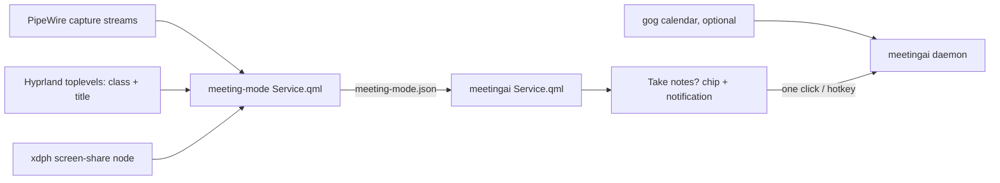

# Spec: catch every call reliably and make taking notes one click

## Decisions on the intent's open questions (the owner approved the proposals)

1. **Calendar:** optional, off by default, read-only through the installed
   `gog` CLI. Used to name meetings and to confirm browser calls.
2. **Where:** extend `nixarchy-meeting-mode`; meetingai reads its state.
   No second detector.
3. **"Maybe" calls:** a dim dot on meetingai's bar widget, no prompt.
4. **Order:** after the UI quality work.

## Design

### A. `nixarchy-meeting-mode` (second repository, its own gates)

- **State file** `$XDG_RUNTIME_DIR/meeting-mode.json` (0600) is written on
  every change to the detection, not only in `start()`/`stop()`. New
  fields, all additive (old readers keep working):
  - `call`: `"none" | "maybe" | "call"`
  - `callApp`: the app (already computed, now always current)
  - `callTitle`: the matching window title, or ""
  - `since`: when the current call or maybe started (epoch ms)
  - `active` keeps its meaning (quiet-desktop actions applied)
- **Two tiers,** in `SettingsModel.js` (pure, unit-tested):
  - `nativeApps`: `zoom|teams-for-linux|teams|discord|vesktop|slack|signal|webex|CiscoCollabHost|element|skype|jitsi`
    → mic held ≥ `startDelay` (3 s) = `call`
  - `browsers`: `chrom|firefox|brave|vivaldi|zen|librewolf|edge`
    → mic held ≥ 3 s = `maybe`; becomes `call` when a confirmer is
    present, or after `maybeDelay` (60 s) of continuous mic
- **Confirmers** (all event-driven through Quickshell, no polling):
  - a window title matching `meetingTitles` (defaults:
    `^Meet - [a-z]{3}-[a-z]{4}-[a-z]{3}`, `\| Microsoft Teams`,
    `^Zoom( Meeting| Workplace)?`, `Jitsi Meet`, `Huddle`, `Webex`,
    `Messenger call`, `WhatsApp.*(call|Call)`), from
    `Hyprland.toplevels`
  - an xdph screen share: a PipeWire `Video/Source` whose `media.name`
    starts with `xdph-streaming-` (the check Omarchy's own sharing
    indicator uses)
  - the Firefox/Zen sharing-indicator window
- **End:** no qualifying mic stream for `endDelay` (15 s, existing).
  Screen share or camera alone never keeps a call alive.
- **Hook:** the existing `onStart` gains a step that runs
  `omarchy-shell meetingai offer` *before* DND turns on, when the
  meetingai plugin is installed (no-op otherwise).
- Titles stay in memory and the 0600 runtime file; never logged.

### B. meetingai

- **`shell/Service.qml`** reacts to `call` (not `active`):
  - `none → call`: if `auto_record_on_call` and not interviewer mode
    (consent stays manual): start recording; else show the offer
  - `→ maybe`: the bar dot only
  - `call → none` while recording: offer "Stop notes" (never stops by
    itself; a call can drop and resume)
  - `callTitle` (or the calendar event) becomes the session title
- **Offer surfaces:**
  - **Bar widget:** a "Take notes?" chip with the app glyph during a
    detected call that isn't recorded; click starts, right-click
    dismisses for this call. DND does not hide it.
  - **Notification** (`notify-send -A take=Take notes`), sent from the
    meeting-mode hook before DND, as a second channel.
  - **IPC/hotkey:** `omarchy-shell meetingai offer` (show the offer) and
    the existing record bind as the one-key accept.
- **Bar states:** dim dot = maybe; outlined dot = call, not recording;
  filled dot + timer = recording (existing). Tooltip: app and title.
- **Calendar (optional, `calendar_enabled` setting, off by default):** the
  daemon runs `gog calendar events --from now-10m --to now+10m --json`
  read-only every 5 min while idle, and on every `call` change. An event
  with a conference link (meet.google.com, teams.microsoft.com, zoom.us)
  names the session and is passed to meeting-mode as a confirmer through
  `$XDG_RUNTIME_DIR/nixarchy-meetingai/calendar.json` (0600). The event
  title stays local.
- **Missing detector:** if `meeting-mode.json` is absent for 30 s after
  start, Settings shows "Call detection is off: enable the meeting-mode
  plugin", with the command.

### C. Nix and nixarchy integration

- meetingai's `flake.nix` takes `nixarchy-meeting-mode` as an input.
- `nix/hm-module.nix` gains `programs.nixarchy-meetingai.callDetection.enable`
  (default true), which adds the meeting-mode plugin to
  `programs.nixarchy.plugins` unless the user already did (no
  duplicate), and sets meeting-mode's new defaults.
- The owner's system config (`~/.config/nixos`) needs no new input; the
  existing `omarchy-meeting-mode.nix` keeps working. Install stays a
  separate step that the owner approves.

## Alternatives rejected

- **A second detector in meetingai's daemon:** two notions of "a call"
  would drift (the reason for the current bug).
- **Weighted multi-signal scoring:** two tiers plus one confirmer cover
  every listed app with rules you can read.
- **Camera polling** (`/dev/video*`): needs polling, and Chrome opens V4L2
  directly; mic plus title already covers the cases.
- **Tab URL through a browser extension or the remote-debugging port:**
  intrusive and a security risk.
- **Hyprland `screencast` events:** stop events are unreliable (Omarchy's
  own code avoids them); the xdph node is used instead.

## Risks

- **Title patterns are unverified** until real calls are made. One short
  test call per app family is part of verification.
- **Only the visible tab's title is seen.** A Meet tab in the background
  stays "maybe" until 60 s or a screen share.
- **Muted calls:** if an app closes the mic stream while muted, a long
  mute could end the call; `endDelay` is configurable.
- **DND ordering:** if the hook runs late, the notification lands in the
  panel; the bar chip still shows.
- **Two repositories:** the meeting-mode change needs its own intent,
  spec and plan in that repo, approved by the owner.

## Verification

- **meeting-mode unit tests** (`tests/model.test.js`): tier
  classification per app name and binary, title confirmers, `maybe → call`
  after 60 s, end delay, state-file content for each transition, no title
  in any log line.
- **meetingai:** `Service.qml` reacts to `call` and not `active` (a
  fake-state-file test: manual meeting mode on with `call: none` gives no
  offer); interviewer mode never auto-records; the offer chip renders in
  a new `SCENARIO=call` crop; calendar parsing unit tests with a fixture
  JSON (no network).
- **Nix:** `nix flake check` in both repos; an HM eval that the plugin is
  added once.
- **Real calls (owner, with the session model):** Meet in Chrome and
  Firefox, Teams PWA, Zoom native, Discord/Vesktop, Slack huddle,
  Messenger. For each, record whether `maybe`, `call` and the end were
  detected, and the latency.
