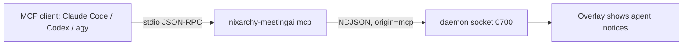

# Spec: MCP server for nixarchy-meetingai

## Decisions on the intent's open questions (the owner approved the proposals)

1. **Recording by agents** is off by default. The setting
   `mcp_allow_record` (false) enables it. The daemon enforces it, not only
   the MCP layer.
2. **Client registration** is documented, not automatic: one `mcp add`
   line per client in the README. Claude Code, Codex and agy all have it
   (`claude mcp add`, `codex mcp add`, `agy mcp add`). Writing those tools'
   own config files from Home Manager is rejected (see below).
3. **Live updates:** polling first. `transcript_get` takes `after_line`.
   No push notifications in this version.

## Design

### 1. The process

`nixarchy-meetingai mcp` is a new subcommand in `src/main.rs` and
`src/cli.rs`. It runs an MCP server over stdio with the official `rmcp`
crate, version 3.8 (verify the server, stdio-transport and macros feature
names against its docs when implementing). It is a thin client: each tool
maps to daemon socket requests. It holds no state beyond one socket
connection, and reconnects once per call if the daemon restarted.

If the daemon isn't running, every tool returns a clear error ("The
nixarchy-meetingai daemon is not running; start
nixarchy-meetingai.service") instead of failing the MCP handshake, so the
client still lists the tools.

### 2. Daemon protocol additions (small)

- Every request may carry `"origin":"mcp"`. The daemon logs each such
  request with `tracing::info!(origin="mcp", cmd)`; arguments are not
  logged.
- New command `transcript.get{meeting?, after_line?, limit≤500}` returns
  `{meeting, lines:[{line, who, speaker, text, t0, t1}]}`. Without
  `meeting` it reads the current session; `line` is the `meeting_lines`
  rowid already used for note coverage.
- New command `now.get` returns
  `{status:"idle"|"listening"|"writing"|"ready", question, answer,
  provider, model, suggestions:[…]}`, from the state the daemon already
  holds for the NOW panel.
- `record.start` with `origin:"mcp"` is refused with "Recording by agents
  is disabled (setting mcp_allow_record)" unless `mcp_allow_record` is
  true.
- When an MCP request starts or stops recording, or asks a question, the
  daemon emits `notice{text}`. The overlay shows it as a quiet line in the
  transcript ("An agent started recording", "An agent asked: …"), so the
  owner always sees agent activity.
- New setting `mcp_allow_record` (bool, default false), visible in
  Settings.

### 3. Tools

All tools return a text summary plus structured JSON.

| Tool | Args | Daemon calls | Notes |
|---|---|---|---|
| `meeting_status` | none | `state.get`, `now.get` | recording, since, mode, providers, NOW status |
| `transcript_get` | `meeting?`, `after_line?`, `limit?` | `transcript.get` | poll with `after_line` for live updates |
| `current_answer` | none | `now.get` | latest question, answer and suggestions |
| `ask` | `question` (≤ 8k characters) | `chat.send`, then wait for `answer.done` or `answer.error` (timeout 120 s) | returns the answer, provider, model and suggestions |
| `meetings_list` | `query?`, `limit?` | `session.list` | filters titles in the client |
| `meeting_notes` | `meeting` | `notes.get` | |
| `notes_regenerate` | `meeting` | `notes.regenerate` | |
| `session_new` / `session_restore` | — / `meeting` | `session.new` / `session.restore` | |
| `record_start` / `record_stop` | none | `record.start` / `record.stop` | start is gated by `mcp_allow_record` |
| `settings_set` | `key`, `value` | `settings.set` | allowlist: `meeting_mode`, `response_pace`, `chat_provider`, `chat_model`, `live_provider`, `live_model`, `text_scale`. Never `api_key` or `mcp_allow_record`. |

Each tool has a one-line description written for an LLM. Tools that change
anything (`record_*`, `session_*`, `settings_set`, `notes_regenerate`)
are marked as non-read-only in their MCP annotations.

### 4. Resources

- `meeting://current/transcript` (text/markdown): the last 200 lines
- `meeting://{id}/transcript`
- `meeting://{id}/notes`

`resources/list` returns the current meeting plus the 20 most recent.

### 5. Packaging

- No new runtime service: the MCP client starts the stdio process.
- The README gets a "Use from AI agents" section with the three
  registration lines, for example
  `claude mcp add --scope user meetingai -- nixarchy-meetingai mcp`.
- Nothing changes in Home Manager beyond the binary already being on PATH.

## Alternatives rejected

- **A hand-written JSON-RPC loop:** about 300 lines, and it would track MCP
  protocol versions and capability negotiation by hand. `rmcp` is the
  official SDK and uses `tokio`, which is already in the build.
- **MCP inside the daemon (an HTTP/SSE transport):** that adds a network
  listener and auth. stdio plus the existing `0700` socket keeps the trust
  boundary where it is.
- **Home Manager writing the clients' MCP config files:** those files are
  owned and rewritten by the clients (`~/.claude.json`,
  `~/.codex/config.toml`, agy's store), and declarative edits would fight
  them. One documented command per client is enough.
- **Push notifications for live transcripts:** client support varies;
  polling with `after_line` works everywhere. Revisit if an agent needs it.
- **Exposing API keys or `mcp_allow_record` over MCP:** an agent must not be
  able to grant itself recording rights.

## Risks

- **rmcp API changes** between minor versions: pin it in `Cargo.toml` and
  cover it with the integration test below.
- **Long `ask` calls:** CLI providers can take 10+ s, and some MCP clients
  time out sooner. Answer within 120 s, or return what has streamed so far
  with `partial:true`.
- **Privacy:** any local MCP client the owner registers can read
  transcripts. This is by design (trusted local agents), and is documented
  in the README with the setting to disable recording.
- **The daemon log** grows with MCP call lines, which are small; journald
  rotation handles it.

## Verification

1. `tests/mcp_flow.rs` spawns `nixarchy-meetingai mcp` against a test
   daemon (the existing `daemon_flow` seams and a fake provider) and
   speaks JSON-RPC over its stdio:
   - `initialize`, `tools/list` (all 12 tools present with schemas)
   - `meeting_status`, then `ask`, which returns the fake answer and
     suggestions
   - `transcript_get` with `after_line`, which returns only newer lines
   - `record_start`, refused by default, and allowed after the owner sets
     `mcp_allow_record` through `settings.set` on the socket (not through
     MCP)
   - `settings_set` with `api_key` or `mcp_allow_record`, which is refused
   - `resources/read meeting://current/transcript`
   - the daemon not running, which gives a clean tool error
2. Unit tests for the daemon's `origin` gate, `transcript.get` paging and
   `now.get`.
3. Manually: `claude mcp add` against the real binary; ask Claude Code
   "what's the status of my meeting?" and "ask the copilot: explain k8s";
   check the overlay shows the notice.
4. The full suite stays green; clippy, rustfmt and `nix flake check` are
   clean.
