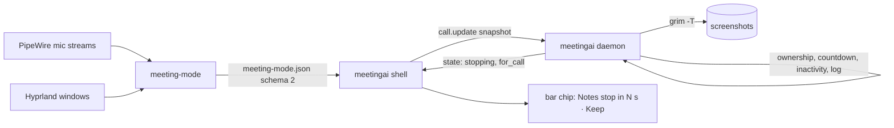

# Spec: Notes finish when the meeting does, and screenshots show only the meeting

## Decisions carried from the approved intent

1. **Notes running when a call starts are adopted by it,** with **Keep
   recording** as the escape. Only a call confirmed by a window or an app
   adopts; the 60 s fallback never adopts (A6).
2. **Inactivity, option (b).**
   - With no call, a long stretch with no sound gives a countdown, then a stop.
   - During a call, it only reminds. **Exception for the owner to confirm:** E1.
   - The length is a setting with an Off choice.
   - **Keep recording** restarts the clock.
3. **No browser extension.** Meetings in their own window or PWA work fully. A
   background tab gets no screenshots while another tab is shown.
4. **Measurement (owner, 2026-11-16):** the spec is written from one real Teams
   session. Meet in Chrome (tab and PWA), Discord and Zoom are measured in
   Verification, before the PR merges.
5. **Screenshots:**
   - off by default and switched on per meeting;
   - they target the meeting window;
   - no automatic fallback;
   - never on by themselves for every call.

## What the Teams session showed (2026-11-16, p620)

The sampler kept only categories and hashes.

- **The Teams client is a QtWebEngine web app:**
  - window class `omateams`;
  - mic stream "Chromium input", from binary `QtWebEngineProcess`.
- **Detected by fallback only.** The detector reached `call` only through the
  60 s `maybeDelay`, 75 s after the mic opened. Its window was never looked at,
  because `omateams` is not in the `browsers` pattern.
- **Teams' title cannot tell a call from no call.** The idle title already
  matches `\| Microsoft Teams`.
- **The mic was released.** On leaving, the stream was destroyed, `call` went
  to `none`, and meetingai's recording ended.
- **Hidden frames were current.** The window's frame hash changed in 4 of 4
  samples taken while it was on a hidden workspace.

## Design

### A. meeting-mode: which window, and when the call ends

This lives in the `nixarchy-meeting-mode` repository, which needs its own
intent → spec → plan. Below is the contract meetingai needs.

**A1. The window of a stream.**
- **The walk:** from the stream's `application.process.id`, follow parent pids
  until reaching a pid that owns Hyprland windows. Each parent comes from
  `/proc/<pid>/stat`: the field after the last `)` is the state, and the one
  after that is the parent.
  - It stops after 8 steps, at pid 1, or when a read fails.
  - The result is kept per stream id. A result that arrives after the stream
    has gone is dropped.
- **That pid has exactly one window:** that window is the stream's window.
- **It has several** (Chrome, where every window shares one pid): the window is
  the one whose title matches a meeting pattern. With none or several matches,
  there is no window yet.

**A2. A binding holds.**
- Once a stream has a window, that binding stays while the window exists, even
  if its title changes, for example on a tab switch.
- It is never moved to another window.

**A3. Kind.** A stream counts as a native call after 3 s, as today, when either:
- its app name or binary matches `nativeApps` (as today);
- **or** its bound window's class matches a new list, `webApps` (default
  `omateams|teams-for-linux`).

Otherwise a browser stream is confirmed only by its *own* bound window's title,
or by the 60 s fallback. A meeting title in another window and the global
screen share no longer confirm it.

**A4. A call ends** when its stream goes away, or its bound window closes. A
lost title does not end it.

**A5. Patterns.**
- `\| Microsoft Teams` is removed: it matches the idle app (measured).
- `^Zoom( Meeting| Workplace)?` becomes `^Zoom Meeting`.

**A6. New state-file fields,** additive, with `schema: 2`:

| Field | Meaning |
|---|---|
| `callWindow` | the `stableId` of the meeting window, or `""` |
| `callWindowState` | `bound`, `none` or `ambiguous`. Ambiguous means the streams in `call` are bound to more than one window. |
| `callWindowShowing` | for a native or web-app window: true. For a browser window: true only while its title matches a meeting pattern. |
| `callBy` | how the call was confirmed: `native`, `webapp`, `title` or `fallback` |

Titles stay where they are today: in memory and in the 0600 file only.

### B. meetingai daemon: the recording owns its end

**B1. Call state comes from one place.**
- Only the shell's `Service` (one instance) sends `call.update`, and each send
  is a complete snapshot:
  `{seq, present, schema, call, since, by, window, window_state, showing}`.
  - `present`: the writer is alive.
  - `schema`: 1 or 2.
- **Sending:** the shell sends only when `CallState` has settled (`seen`, with
  no pid probe running). It sends once on every daemon connect, before
  `react()` may auto-record, and then on every change.
- **Receiving:** the daemon applies only a newer `seq`, and keeps the snapshot
  in memory.
- **Agents:** agents (MCP and `agent` origin) cannot send it, and never see any
  of it.
  - The daemon's `state` carries only `for_call`, `stopping` and the autoshots
    status. None of these holds a title or a window id.
  - In Local-only, these fields follow the existing redaction (`session.rs:6010`).

**B2. Ownership: `for_call`, per recording.** A recording is identified by
`meeting@since`, as `recId()` is today.
- **When it is set, with `schema` 2:**
  - the recording starts while `call` is `call`;
  - or a call with `by ≠ fallback` starts (edge `none`/`maybe` → `call`, new
    `since`) while recording (adoption).
- **With `schema` 1:** set only when the recording started at most 5 s before
  or after the call's `since`. This is #64's rule; there is no adoption.
- **Keep recording** clears it, and records `kept_since = since`. A replayed
  snapshot of the same call never adopts again.

**B3. Countdown, level-triggered.**
- **A call-end countdown runs** while all of these hold:
  - recording;
  - `for_call`;
  - `present`;
  - `call` is not `call`.

  It is re-evaluated on every `call.update`. A countdown cancelled because the
  writer was gone therefore restarts once the writer is back and still says
  `none`.
- **An inactivity countdown** comes from B4.
- `stopping: {rec, reason, at}`, 30 s. If both reasons apply, call end wins.
- **Cancelled by:**
  - `record.keep {rec}`, where `rec` must match;
  - a manual stop or start;
  - the condition no longer holding;
  - for inactivity, sound returning (B4).
- **Expiry:** under the daemon lock, it re-checks that the same `rec` is still
  recording and the condition still holds, then stops with the reason.
- **A daemon restart** ends any recording, as today (`session.rs:1252`). A
  countdown is never persisted.

**B4. Inactivity, by sound level, the same for every engine.**
- **The clock:** the daemon's audio loop sees both channels before any engine
  (`SessionEvent::Audio`, where `levels.feed` already measures each channel,
  `session.rs:3471`). `last_sound[channel]` is set when a channel stays above
  `transcription.rs`'s `SOUND_LEVEL` (0.008) for at least 300 ms within a 1 s
  window.
  - This catches voice as well as music and steady noise.
  - Steady noise keeps the clock alive, which fails safe: no stop.
- **No call** (`present` and `call` is `none`): only the mic counts. After N
  min with no mic sound, the inactivity countdown starts. Mic sound during the
  countdown cancels it.
- **During a call,** with `maybe`, or with `present` false: after N min with no
  sound on either channel, one notice and a bar chip say "No sound for N min ·
  Stop notes". No stop (but see E1).
- **No audio frames arriving at all** (capture failed): the state is unknown.
  The clock does not advance, and nothing stops.
- **The setting:** `inactivity_stop_minutes`, default 10, with 0 for off. It is
  added in Settings, in the Nix module and in the settings schema, following
  `auto_record_on_call`.
- **Keep recording** on an inactivity countdown restarts the clock.

**B5. Logging.** One `tracing::info!` line per event: `event`, `rec`, `reason`,
`origin`. The events:
- record start and stop;
- adopt, keep and kept;
- countdown start, cancel (with its cause) and expire;
- inactivity reminders;
- `call.update` transitions: present, schema, call, by, window_state;
- autoshot pauses and skips, with their cause.

No titles, no transcript text, no window ids.

### C. meetingai shell

- **C1. Report, don't decide.** `Service.qml` sends the B1 snapshot. It drops
  `forCall`, `ownerSince`, `pendingStop`, `stopTimer`, `handledFor`, `keptFor`
  and `slackMs`.
  - Auto-record and the "Take notes?" offer stay.
  - "The call ended. Notes are still recording" stays, for a recording without
    `for_call` once the call ends.
- **C2. A visible countdown.**
  - While `state.stopping` is set, the bar shows "Notes stop in N s". A click
    sends `record.keep {rec}`.
  - `notify-send -A keep` is still sent; its answer also carries `rec`.
  - The meeting view shows the same line.
- **C3. The meeting, identified.**
  - The bar tooltip and the meeting view show the app and the window state: a
    window found, no window, or several windows (unclear).
  - Title text stays shell-local, as today (`BarWidget.qml:39`).

### D. Auto screenshots of the meeting window

- **D1. Start.** `autoshots.start` binds to the snapshot's `window`. It is
  refused, with the reason shown on the control, unless all of these hold:
  - `present`;
  - `schema` 2;
  - `call` is `call`;
  - `window_state` is `bound`.

  The #84 refusals for Local-only and consent stay.
- **D2. Eligible to capture.** All of these must hold, both before `grim` runs
  and again under the lock before the image is stored:
  1. the #84 checks;
  2. `present`, `call` is `call`, and `window_state` is `bound` with the same
     `window`;
  3. `showing`;
  4. no `stopping` countdown;
  5. the window still exists in `hyprctl clients -j`.

  Otherwise the capture is skipped, and the control shows "Paused: <cause>".
  Captures resume when the conditions hold again.
- **D3. Capture.** `grim -T <stableId>` replaces `grim -g <area>` in both the
  fingerprint and the PNG (`auto_image`, `screen_area`). Each `grim` run has a
  3 s timeout.
- **D4. Freshness.**
  - If the window is not on a visible workspace, take two fingerprints 1 s
    apart. If they are identical, the frame may be stale: skip, with "Paused:
    window hidden and not updating".
  - A visible window has no such check.
  - A static shared slide on a hidden workspace is skipped too. That errs on
    the safe side.
- **D5. A closed window.** Autoshots go to "Paused: meeting window closed".
  Pressing the control again re-binds to the current `window`. `auto_start_at`
  accepts this paused state as restartable.
- **D6. The rectangle is removed from auto screenshots.** The manual screenshot
  key keeps `slurp`. **The owner confirms this (intent question 5).**
- **D7. Stop → Play** keeps the binding only while the same `stableId` exists
  and the call is on. Otherwise it is off.

### E. For the owner to decide

**E1. Apps that keep the mic after the meeting.** Discord in a voice channel
does this; Chrome Meet is unmeasured. Then `call` stays on. Under decision 2,
the notes stop only by a click on the reminder. That misses the intent's "capture stops ... for
apps that keep the mic open". **Recommended:** during a call, after **3 × N**
(30 min) with no sound on *either* channel, run the countdown and stop. A quiet
webinar gets the visible chip and one click to keep.
- Without E1, the outcome is narrowed to "reminded".
- If the owner rejects E1, the intent is revised to say so.

## Alternatives rejected

- **A Chrome extension:** decision 3. A state-only extension remains the next
  step if Meet in a background tab matters.
- **The daemon reading `meeting-mode.json` itself:** that would be two readers
  next to `CallState.qml`'s writer check. Cost: a recording started from the
  CLI with no shell running gets reminders only. Accepted: the shell runs on
  every host that records.
- **Real voice detection (VAD)** for inactivity: no engine-independent VAD is
  in the tree. Sound level fails safe.
- **Stopping on title loss, or on remote silence alone:** a tab switch or a
  quiet webinar looks the same. These only pause screenshots or remind.
- **Calendar end time:** optional and usually off.
- **Portal ScreenCast or `hyprland-toplevel-export`:** a consent dialog, or a
  protocol client. `grim -T` already works.
- **Keeping the countdown in the shell (#64):** its restart limits are the
  leaks the intent lists.

## Risks

- **Two repositories.** meetingai ships first. With schema 1 it keeps #64's
  behaviour, through the daemon countdown.
- **Same-window views** (a Teams or Slack chat in the call's window) can be
  captured: the title cannot tell. Limits: the off default, the indicator,
  delete, and pausing once the call ends.
- **The process walk** may fail for sandboxed apps. Then there is no window, a
  refusal says why, and the end is detected by stream only.
- **Sound level is not voice.** Steady noise delays inactivity stops. That is
  the safe direction.
- **Hosts:** p620 and razer. The daemon, the shell and meeting-mode all change.

## Verification

- **meeting-mode** (its repository, `tests/model.test.js`):
  - parsing the parent from `stat`, including a `)` in the name;
  - walk limits;
  - window choice when one, several or no windows match, and stale results;
  - a binding held through a title change;
  - `webApps` classification;
  - per-stream confirmation;
  - a bound window closing ends the call;
  - `ambiguous` across streams;
  - the patterns;
  - the schema 2 fields.
- **meetingai Rust,** with a fake clock, fake capture and fake levels:
  - ownership: schema 2 start and adoption; no adoption by `fallback`; the
    schema 1 5 s rule; Keep blocks re-adoption on a replayed snapshot;
  - the countdown is level-triggered: restarted after `present` returns; a
    `seq` older than the last is ignored; Keep with the wrong `rec` is ignored;
    expiry with a new recording does not stop it; call end wins over
    inactivity;
  - inactivity: none → countdown; mic sound cancels it; system sound ignored
    when there is no call; reminder only during a call; E1, if approved; no
    frames → no stop; 0 = off;
  - autoshots: refusals; each pause cause; the re-check before storing; the
    hidden-and-identical skip; the 3 s timeout; restart after close;
  - agents cannot send `call.update` or `record.keep`, and see no call fields;
    Local-only redaction;
  - log lines carry no title.
- **Shell** (`shell/tests`):
  - the snapshot is sent after settling and before auto-record on connect;
  - the countdown chip and Keep send `rec`;
  - window-state display;
  - the existing #64 cases moved to the daemon countdown.
- **Live, with the sampler,** on p620 before merge: join and leave a Meet tab,
  a Meet PWA, Teams (`omateams`) and a Discord voice channel. For each, record:
  - the end and its delay;
  - the window state;
  - autoshot pauses, and freshness while hidden;
  - the chip with Do Not Disturb on.

  The results go into the PR. The samples are deleted afterwards.
- `cargo test`, `bash shell/tests/ci.sh`, `nix flake check`, and the
  meeting-mode tests.
