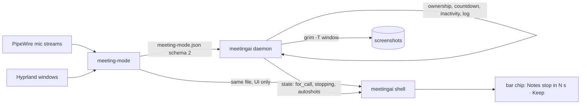

# Spec: Notes finish when the meeting does, and screenshots show only the meeting

## Decisions carried from the approved intent

1. **Notes running when a call starts are adopted by it,** with **Keep
   recording** as the escape. Only a call confirmed by an app, a web-app window
   or its own window title adopts. The 60 s fallback never does (B2).
2. **Inactivity, option (b).**
   - With no call, a long stretch of quiet gives a countdown, then a stop.
   - During a call, it reminds; F1 adds a long-stop for the owner to confirm.
   - The length is a setting with an Off choice.
   - **Keep recording** restarts the clock.
3. **No browser extension.** Meetings in their own window or PWA work fully. A
   background tab gets no screenshots while another tab is shown.
4. **Measurement order** (owner, 2026-11-16, "ok continue approved" to writing
   the spec from the Teams session): Meet in Chrome (tab and PWA), Discord and
   Zoom are measured in Verification, before the PR merges.
5. **Screenshots:**
   - off by default and switched on per meeting;
   - they target the meeting window;
   - no automatic fallback;
   - never on by themselves for every call.

## What the Teams session showed (2026-11-16, p620)

The sampler kept only categories and hashes.

- **The Teams client is a QtWebEngine web app:**
  - window class `omateams`;
  - mic stream "Chromium input", from binary `QtWebEngineProcess`.
- **Detected by fallback only.** The detector reached `call` only through the
  60 s `maybeDelay`, 75 s after the mic opened. Its window was never looked at,
  because `omateams` is not in `browsers`.
- **Teams' title cannot tell a call from no call.** The idle title already
  matches `\| Microsoft Teams`.
- **The mic was released.** On leaving, the stream was destroyed, `call` went
  to `none`, and the recording ended.
- **The hidden window's frames changed.** The window's frame hash differed in
  4 of 4 samples taken while it was on a hidden workspace. That shows the
  window was repainting, not that every part of it was current.

## Design

### A. meeting-mode: which window, and when the call ends

This lives in the `nixarchy-meeting-mode` repository, which needs its own
intent → spec → plan. Below is the contract meetingai needs.

**A1. Candidate windows of a stream.**
- **The walk:** from the stream's `application.process.id`, follow parent pids
  until reaching a pid that owns Hyprland windows. Each parent comes from
  `/proc/<pid>/stat`: slice after the *last* `)`, and the second field after
  that slice is the parent.
  - It stops after 8 steps, at pid 1, or when a read fails.
  - The result is cached per stream id together with its pid, so a reused
    stream id with a new pid starts again.
  - Lookups never run on the 1 s tick.
  - `pid` and `stableId` are read from `Hyprland.toplevels`'
    `lastIpcObject`; when they are missing, the code calls
    `Hyprland.refreshToplevels()`.
- **Candidates:** all windows of that pid. With more than one (Chrome), only
  those whose title matches a meeting pattern.

**A2. Binding.**
- A stream is bound when it has exactly one candidate.
- The binding holds while that window exists, through title changes such as a
  tab switch. It is never moved to another window.
- A stream with two or more candidates is `ambiguous`. One with none is
  unbound.

**A3. Kind.** A stream counts as a native call after 3 s, as today, when either:
- its app name or binary matches `nativeApps`;
- **or** its bound window's class matches `webApps` (default
  `omateams|teams-for-linux`).

Otherwise a browser stream is confirmed only by its *own* bound window's title,
or by the 60 s fallback. A meeting title in another window and the global
screen share no longer confirm it.

**A4. A call ends** when its stream goes away, or its bound window closes. A
lost title does not end it.

**A5. Patterns.**
- `\| Microsoft Teams` is removed (measured to match the idle app).
- `^Zoom( Meeting| Workplace)?` becomes `^Zoom Meeting`.

**A6. New state-file fields,** additive, with `schema: 2`:

| Field | Meaning |
|---|---|
| `callWindow` | the `stableId` of the meeting window, when the window state is `bound`; else `""` |
| `callWindowState` | `bound` when every stream in `call` is bound to the same single window; `ambiguous` when any is ambiguous or they are bound to different windows; else `none` |
| `callWindowClass` | the class of the bound window, shown in the meetingai UI |
| `callWindowShowing` | for a native or web-app window: true. For a browser window: true only while its title matches a meeting pattern. |
| `callBy` | how the call was confirmed: `native`, `webapp`, `title` or `fallback` |
| `callWindowSeq` | a counter, incremented whenever `callWindow` or `callWindowShowing` changes, so a reader that polls cannot miss a change that reverted between polls |

Titles stay where they are today: in memory and in the 0600 file only.

### B. meetingai daemon: one reader, and the recording owns its end

**B1. The daemon reads the call state itself.**
- It checks `$XDG_RUNTIME_DIR/meeting-mode.json` once a second by its change
  time, and parses it on change.
- It validates the writer the way `CallState.qml` does: it probes
  `/proc/<pid>`, a new pid counts as gone until the probe passes, and an old
  file with no pid is stale after 600 s.
- The result is kept in memory:
  `{present, schema, call, since, by, window, window_state, window_class, showing}`.
  Titles are never read into it.
- **Recovery:** this is the same reader that runs for the CLI and with no
  shell. A shell restart changes nothing. A daemon restart ends any recording
  (as today, `session.rs:1252`) and re-reads the file.
- The shell keeps `CallState.qml` for its own display and auto-record offer.
  The daemon's reading decides ownership, stopping and screenshots.

**B2. Ownership: `for_call`, per recording.** A recording is identified by
`meeting@since`.
- **Set when, with schema 2 and `present`:**
  - the recording starts while `call` is `call`;
  - **or** a call whose `since` has not been handled before reaches `call`
    with `by ≠ fallback` while recording (adoption). A `maybe` → `call` step
    keeps its `since`, and still adopts the first time.
- **With schema 1:** set when `recording_since ≥ call_since − 5 s`, which is
  #64's rule. There is no upper bound and no adoption.
- **Keep recording** clears it and marks the recording kept. A kept recording
  is never adopted again, by this call or by a blip of it.

**B3. Countdown.**
- **A call-end countdown runs** while all of these hold:
  - recording;
  - `for_call`;
  - `present`;
  - `call` is not `call`.

  It is re-evaluated on every change of the reading.
- **An inactivity countdown** comes from B4. Call end wins when both apply.
- **Every automatic stop countdown lasts 30 s,** for call end, inactivity and
  F1 alike, as #64 does today.
- **Each countdown gets a fresh `gen`** (a counter). `stopping` is
  `{gen, reason, at}`.
- **`record.keep {gen}`** acts only on the current `gen`.
- **Expiry** acts only when, under the lock, its `gen` is still current, the
  same recording is running, and the condition still holds.
- **Cancelled by:**
  - Keep;
  - a manual stop or start;
  - the condition no longer holding;
  - for inactivity, sound returning (B4).
- A countdown is never persisted.

**B4. Inactivity, by sound level, the same for every engine.**
- **The clock:** the daemon's audio loop sees both channels before any engine
  (`SessionEvent::Audio`, where `levels.feed` measures each channel,
  `session.rs:3471`). `last_sound[ch]` is set when the channel stays above
  `SOUND_LEVEL` (0.008, `transcription.rs:412`) for at least 300 ms within a
  1 s window.
- **Resets:** the clock is set to *now* on:
  - a recording start or Play;
  - each change of `call`;
  - Keep;
  - the first audio frame after a gap of 5 s or more.

  So it never starts from an old time.
- **No call** (`present` and `call` is `none`): only the mic counts. After N
  min with no mic sound, the inactivity countdown starts. Mic sound cancels it.
- **During a call, with `maybe`, or when not `present`:** after N min with no
  sound on either channel, a chip "No sound for N min · Stop notes" appears in
  the bar. Nothing stops; F1 adds a stop for a call.
- **No audio frames at all** (capture failed): unknown. The clock does not
  advance, and nothing stops.
- **The setting:** `inactivity_stop_minutes`, default 10, with 0 for off. It is
  added in Settings, in the Nix module and in the schema, following
  `auto_record_on_call`.

**B5. Logging.** One `tracing::info!` line per event: `event`, `reason`,
`origin`. The shell now sends `origin: "shell"`; a missing origin logs as
`cli`. The events:
- record start and stop;
- adopt, keep and kept;
- countdown start, cancel (with its cause) and expire;
- inactivity chips;
- **a call ended while recording without `for_call`:** the "offered, not taken"
  case;
- call-state transitions: present, schema, call, by, window_state;
- autoshot pauses and skips, with their cause.

No titles, no transcript text, no meeting or window ids.

**B6. What leaves the daemon.**
- `state` gains these fields, holding only booleans, enums and numbers:
  - `for_call`;
  - `stopping {gen, reason, in_s}`;
  - `inactivity_chip`;
  - `autoshots {on, count, paused: <cause>}`;
  - `call_window {state, class}`.
- `call_window.class` is removed:
  - from every reply to an agent (MCP or `agent` origin), in any mode;
  - in Local-only, also from the broadcast `state` event (the list at
    `session.rs:6010`).

  The other fields carry nothing about the meeting.
- `record.keep` is not on the agent (MCP or `agent`) allow-lists.

### C. meetingai shell

- **C1. The shell no longer decides the end.** `Service.qml` drops `forCall`,
  `ownerSince`, `pendingStop`, `stopTimer`, `handledFor`, `keptFor` and
  `slackMs`.
  - Auto-record and the "Take notes?" offer stay.
  - "The call ended. Notes are still recording" stays, for a recording without
    `for_call`.
- **C2. A visible countdown.**
  - While `state.stopping` is set, the bar shows "Notes stop in N s · Keep". A
    click sends `record.keep {gen}`.
  - `notify-send -A keep` is still sent and carries `gen`.
  - The meeting view shows the same line.
  - The inactivity chip works the same way, with **Stop notes**.
- **C3. The meeting, identified.** The bar tooltip and the meeting view show
  one of:
  - the app and the window class ("Teams · window omateams");
  - "no meeting window";
  - "several possible windows".

### D. Auto screenshots of the meeting window

- **D1. Start.** `autoshots.start` binds to the reading's `window`. It is
  refused, with the reason shown on the control, unless all of these hold:
  - `present`;
  - schema 2;
  - `call` is `call`;
  - the window state is `bound`.

  The #84 refusals for Local-only and consent stay.
- **D2. An eligibility generation.** `elig_gen` increments whenever a capture
  would become ineligible, that is when any of these changes:
  - the call or the window, including a new `callWindowSeq`;
  - `showing`;
  - a countdown;
  - the lock state;
  - the #84 checks.

  A capture records `elig_gen` before running `grim`. It is stored only if the
  value is unchanged and every check passes again under the lock. A change
  that reverts during the capture still discards it. The existing generation
  guard (`session.rs:2975`) stays.
- **D3. Eligibility.** All of these must hold:
  1. the #84 checks;
  2. `present`, `call` is `call`, and the window state is `bound` with the same
     `window`;
  3. `showing`;
  4. no countdown;
  5. the window still exists in `hyprctl clients -j`.

  Otherwise the control shows "Paused: <cause>".
- **D4. Capture.** `grim -T <stableId>` replaces `grim -g <area>` for both the
  fingerprint and the PNG (`auto_image`, `screen_area`). Each `grim` run has a
  3 s timeout.
- **D5. A hidden window must be repainting.** If the window is not on a visible
  workspace, take two fingerprints 1 s apart. If they are identical, skip it
  with "Paused: window hidden and not updating". A visible or covered window
  is repainted by the compositor and is not checked. This is the guarantee F2
  asks the owner to accept.
- **D6. A closed window.** Autoshots go to "Paused: meeting window closed".
  Pressing the control again re-binds to the current `window`.
  `auto_start_at` treats that paused state as restartable.
- **D7. Stop → Play** keeps the binding while the same `stableId` exists and
  the call is on. Otherwise it is off.
- **D8. The rectangle is removed from auto screenshots.** The manual screenshot
  key keeps `slurp`. With an old meeting-mode (schema 1), auto screenshots are
  therefore unavailable, with a reason. **The owner confirms (F3).**

### F. Owner decisions (approved 2026-11-16: all recommendations)

Each item changes an approved intent outcome. Approving the spec with an
answer updates the intent in the same commit.

- **F1. Apps that keep the mic after the meeting.** Discord in a voice channel
  does this; Chrome Meet is unmeasured. The call stays on, and nothing on this
  machine can say the meeting is over. The intent's "within about a minute ...
  including apps that keep the mic open" cannot be met without a per-app
  signal.
  - **Recommended:** amend the outcome. Such apps get the inactivity chip after
    N min, and, during a call, a countdown and stop after **3 × N** (30 min)
    with no sound on either channel.
  - Media resumed on the system channel would block that stop. Discord in a
    voice channel and Chrome are tested in Verification.
- **F2. Freshness.** The intent says no capture "when its frames may be
  stale". Nothing can prove a window's content is current.
  - **Recommended:** amend it to "a hidden window that is not repainting is
    skipped" (D5).
- **F3. The rectangle.** Remove it from auto screenshots, as recommended in
  D8. The cost: no auto screenshots with an old meeting-mode.
- **F4. Voice vs sound.** The intent says "no voice detected". There is no
  engine-independent voice detector in the tree. Sound level fails on the safe
  side: steady mic noise keeps a forgotten recording alive.
  - **Recommended:** amend the outcome to "no sound".
  - Upgrade path: a VAD model, if this proves to leak in practice.
- **F5. Which Chrome tab holds the mic.** Chrome reports one audio process for
  all its tabs. So a meeting title in a Chrome window does not prove the mic
  stream belongs to that tab. If another tab (a voice note, a different call)
  holds the mic, that window can be taken as the meeting: for adoption and for
  screenshots.
  - **Recommended:** accept this for Chrome, since a Meet PWA or a window of
    its own has one tab.
  - Upgrade path: the state-only extension (decision 3).

## Alternatives rejected

- **The shell forwarding call state to the daemon** (the earlier draft): it
  needed sequence numbers that reset on a shell restart, liveness detection for
  the forwarder, and a reconnect barrier. It also left CLI recordings with no
  detector. One reader in the daemon removes all of that. The shell's
  `CallState` remains for display only.
- **A Chrome extension:** decision 3.
- **Real voice detection (VAD):** F4.
- **Stopping on title loss, or on remote silence alone:** a tab switch or a
  quiet webinar looks the same.
- **Calendar end time:** optional and usually off.
- **Portal ScreenCast or `hyprland-toplevel-export`:** a consent dialog, or a
  protocol client. `grim -T` works.
- **Keeping the countdown in the shell (#64):** its restart limits are the
  leaks the intent lists.

## Risks

- **Two repositories.** meetingai ships first. With schema 1, ownership and
  the countdown follow #64's rule, now in the daemon, and auto screenshots are
  unavailable (F3).
- **Same-window views** (a Teams or Slack chat in the call's window) can be
  captured: the title cannot tell. Limits: the off default, the indicator,
  delete, and pausing once the call ends.
- **A Chrome title binding does not prove which tab owns the mic.** See F5.
- **The process walk may fail** for sandboxed apps: no window, and the
  refusal says why.
- **Two readers of one file** (the daemon decides; the shell displays). Both
  use the same validation rules, and the shell shows the daemon's
  `call_window` state, so a mismatch is visible.
- **Hosts:** p620 and razer. The daemon, the shell and meeting-mode all change.

## Verification

- **meeting-mode** (its repository, `tests/model.test.js`):
  - `stat` parsing with `)` and spaces in the name;
  - walk limits;
  - cache invalidation on stream id reuse;
  - the candidate, binding, ambiguity and aggregate rules;
  - a binding held through a title change;
  - `webApps`;
  - per-stream confirmation;
  - a bound window closing ends the call;
  - the patterns;
  - the schema 2 fields.
- **meetingai Rust,** with a fake clock, fake capture, fake levels and fake
  state files:
  - the reader: pid probe, a new pid gone until probed, a stale file with no
    pid, schema 1 versus 2, no titles kept;
  - ownership:
    - start during a call;
    - adoption once per `since`, including `maybe` → `call`;
    - no adoption by `fallback`;
    - schema 1's `≥ since − 5 s` with no upper bound;
    - a kept recording never re-adopted;
  - the countdown:
    - level-triggered;
    - `gen` guards on Keep and expiry, including countdown A and then B on the
      same recording;
    - call end wins;
    - a manual stop cancels;
  - inactivity:
    - every reset point;
    - none → countdown;
    - mic sound cancels;
    - system sound ignored with no call;
    - a chip only during a call;
    - F1 if approved;
    - no frames → no stop;
    - 0 = off;
  - autoshots:
    - refusals and each pause cause;
    - an `elig_gen` change that reverts during capture is discarded;
    - hidden-and-identical skipped;
    - the 3 s timeout;
    - restart after a close;
  - agents cannot send `record.keep`;
  - Local-only strips `call_window.class` from both replies and broadcasts;
  - no title, meeting id or window id in the logs.
- **Shell** (`shell/tests`):
  - the countdown and inactivity chips;
  - Keep sends `gen`;
  - window-state display;
  - `origin: "shell"`;
  - the #64 cases moved to the daemon.
- **Live, with the sampler,** on p620 before merge: join and leave a Meet tab,
  a Meet PWA, Teams (`omateams`), a Discord voice channel and Zoom. For each,
  record:
  - the end and its delay;
  - the window state;
  - autoshot pauses, and the hidden repaint check;
  - the chips with Do Not Disturb on.

  The results go into the PR. The samples are deleted afterwards.
- `cargo test`, `bash shell/tests/ci.sh`, `nix flake check`, and the
  meeting-mode tests.
