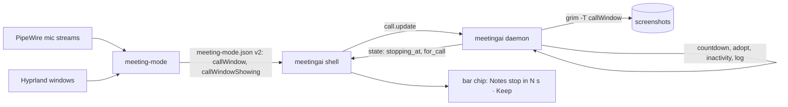

# Spec: Notes finish when the meeting does, and screenshots show only the meeting

## Decisions carried from the approved intent

1. **Notes running when a call starts are adopted by it,** with **Keep
   recording** as the escape. This applies only once the false-call paths are
   fixed (part A).
2. **Inactivity, option (b):**
   - with no call detected, a long stretch with no speech gives a countdown,
     then a stop;
   - during a call, it only reminds;
   - the length is a setting with an Off choice;
   - "no speech" means no voice detected, not "no transcript text";
   - **Keep recording** restarts the clock.
3. **No browser extension.** Meetings in their own window or PWA work fully. A
   background tab gets no screenshots while another tab is shown.
4. **Measurement:** the test session (below) replaces the scripted call; the
   remaining apps are checked in verification.
5. **Screenshots:**
   - off by default and switched on per meeting;
   - they target the meeting window;
   - no automatic fallback.

## What the test session showed (2026-11-16, p620, a real Teams call)

The sampler kept only categories and hashes (`scratchpad/measure/sample.sh`).

- **The Teams client is a QtWebEngine web app,** not Chrome:
  - window class `omateams`;
  - mic stream "Chromium input", from binary `QtWebEngineProcess`.
- **Detected by fallback only.** The detector reached `call` only through the
  60 s `maybeDelay`, 75 s after the mic opened. `omateams` is not in the
  `browsers` pattern, so its window was never looked at.
- **Teams' title cannot tell a call from no call.** The idle Teams title
  already matches `\| Microsoft Teams`. It also matches outside the "Chat |",
  "Calendar |" views.
- **The mic was released.** On leaving, the stream was destroyed, `call` went
  to `none`, and meetingai's recording ended.
- **Hidden frames were current.** The Teams window's frame hash changed in all
  4 samples taken while it sat on another workspace. The sample is small.
- **Not measured:** Meet in Chrome (tab and PWA), Discord, Zoom. They are
  covered in Verification.

## Design

The parts, and who changes what:

### A. meeting-mode: who is in a call, and in which window

The repository is `nixarchy-meeting-mode`, and it needs its own intent → spec →
plan. This section is the contract meetingai needs.

**A1. Each stream gets its own window.**
- **Native apps and web-app shells (`omateams`):** walk the stream's
  `application.process.id` up its parent chain, through `/proc/<pid>/stat`, to
  the first pid that owns a Hyprland window. The window must be unique for
  that pid.
- **Chrome:** every window shares one pid. Among that pid's windows, the one
  whose title matches a meeting pattern is the meeting window. If none or
  several match, there is no window.

**A2. Confirmation is per stream.** A browser stream is confirmed by:
- its own bound window's title;
- the 60 s fallback, as today.

Another window's title or a screen share elsewhere no longer confirms it. The
global `screenShared` flag stops being a confirmer.

**A3. A call ends on certain evidence only:**
- the stream goes away (as today);
- **or** its bound window closes.

A tab switch, which loses the title, still does not end it (`confirmedIds`
stays). An idle or paused stream is not used in this task: Quickshell's
PipeWire API was not checked for it, and the measurement did not need it.

**A4. Loose patterns are removed:**
- `\| Microsoft Teams`: it matches the idle app (measured);
- `^Zoom( Meeting| Workplace)?` becomes `^Zoom Meeting`.

The Teams web app then relies on the mic plus the 60 s fallback.
`teams-for-linux` and `omateams` are added to `nativeApps`, so their mic counts
as a call after 3 s.

**A5. New state-file fields,** additive (`schema: 2`):
- `callWindow`: the Hyprland `stableId` of the bound window, or `""`;
- `callWindowShowing`: true for a native or web-app window. For a browser
  window, true only while its title still matches a meeting pattern.

Titles stay as they are today: in memory and in the 0600 file only.

### B. meetingai daemon: the recording owns its end

The countdown and the ownership move from the shell into the daemon. A
restarted shell or detector then no longer loses them. That removes #64's
accepted restart limits (intent, "Accepted #64 limits").

**B1. Call state comes from the shell.**
- A new `call.update {call, since, window, showing, known}` request. `known` is
  false when the writer is gone or the file has no `schema: 2`.
- The shell sends it on every change and on reconnect.
- The daemon keeps it in memory, with no titles.
- It is not on the agent (MCP) allow-lists, and in Local-only it is not echoed
  in `state`.

**B2. Ownership: `for_call`.** The recording carries a flag:
- **set:**
  - when the recording starts while `call` is `call` (auto-record, or by hand
    during a call);
  - **or** when a call starts while recording and `known` is true (adoption,
    decision 1);
- **cleared** by **Keep recording**;
- reported in `state`.

This replaces the shell's timestamp test (`forCall()`, `ownerSince`,
`slackMs`).

**B3. A countdown in the daemon.**
- `stopping: {at, reason}` lives in the daemon state, and is reported in
  `state`.
- **Started** when either holds:
  - `call` leaves `call`, `for_call` is set and `known` is true
    (`reason: "call_end"`, 30 s);
  - inactivity fires (B4, `reason: "inactivity"`, 30 s).
- **Cancelled** when any of these happens:
  - `record.keep`, which also clears `for_call` (call end) or resets the clock
    (inactivity);
  - a manual stop or start;
  - `call` returning to `call` (a takeover, as in #64);
  - `known` turning false.
- **Expiry** runs the normal stop path with that reason.
- `record.keep` is not on the agent allow-lists.

**B4. Inactivity (decision 2).**
- **Clock:** `last_voice[channel]`, set by `LiveEvent::SpeechStarted`
  (`src/daemon/session.rs:2620`). Both engines emit it: the local one from the
  chunker (`transcription.rs:1345`), the online ones from the provider.
- **No call** (`call` is `none` and `known` is true): only the mic channel
  counts. After N min with no mic voice, the countdown starts. Resumed media on
  the system channel therefore cannot keep the notes alive.
- **During a call, or with `known` false:** after N min with no voice on either
  channel, one notice says "No one has spoken for N min" with **Stop notes**.
  Nothing stops.
- **Setting:** `inactivity_stop_minutes`. The default is 10; 0 means off. It
  lives in Settings and has a Nix option, following the existing settings
  pattern.
- **Engine errors:** a failed engine produces no voice events. It would look
  like silence, so voice is measured where the audio is chunked, before the
  engine. `SpeechStarted` from the local chunker is that place. For online
  engines, the daemon also counts the local chunker's openings; the plan
  confirms the chunker runs for both.

**B5. Logging.** One `tracing::info!` line per event, with fields: event,
reason and origin (`shell`, `cli`, `mcp`, `auto`). The events:
- record start and stop;
- adopt and keep;
- countdown start, cancel and expire;
- inactivity reminders;
- `call.update` transitions: call, known, a window present or not;
- autoshot skips, with the reason.

They never carry titles, transcript text or ids beyond the meeting id.

### C. meetingai shell

- **C1. Report, don't decide.** `Service.qml` sends `call.update` and drops
  `forCall`, `ownerSince`, `pendingStop`, `stopTimer`, `handledFor` and
  `keptFor`.
  - Auto-record and the "Take notes?" offer stay as they are.
  - The "The call ended. Notes are still recording" offer stays, for notes
    without `for_call`.
- **C2. A visible countdown.** While `state.stopping` is set, the bar widget
  shows a chip, "Notes stop in N s", that cancels when clicked
  (`record.keep`).
  - The `notify-send` with **Keep recording** is still sent as a second
    channel.
  - Do Not Disturb cannot hide the bar.
  - The meeting view shows the same line.
- **C3. Fallback.** With an old meeting-mode (`known` false), notes started for
  a call behave as #64 does today, through the daemon's countdown. Adoption and
  window screenshots stay off.

### D. Auto screenshots target the meeting window

- **D1. Start.** `autoshots.start` with no area binds to the call. It is
  refused, with a reason shown on the control, when:
  - `known` is false;
  - `call` is not `call`;
  - `window` is empty.

  The other #84 refusals stay: Local-only and consent.
- **D2. Each capture checks, in order:**
  1. the #84 checks: same meeting, not Local-only, consent, unlocked;
  2. `call` is `call`, so captures pause during the stop countdown and after
     the call;
  3. `showing` is true;
  4. the window still exists in `hyprctl clients -j` with that `stableId`.

  If any check fails, the capture is skipped and the control shows "Paused: …".
  When the call comes back, captures resume.
- **D3. Capture.** `grim -T <stableId>` replaces `grim -g <area>` in both the
  fingerprint and the PNG (`auto_image`, `screen_area`). Each run gets a 3 s
  timeout.
  - The existing `same_frame` check drops repeated frames, including frozen
    hidden ones after the first.
  - The window binding is kept for the meeting. A window that closes and
    reopens is not re-bound automatically: a new `stableId` needs a new start.
- **D4. The rectangle.** The `slurp` rectangle is removed from auto
  screenshots. The manual screenshot key is unchanged. **Owner's call:**
  approve dropping it, or keep it as a separately labelled "Capture an area"
  choice with #84's weaker guarantee.
- **D5. Never on by itself** for every call. This keeps #84's decision; the
  owner may reverse it later as a separate change.
- **D6. Stop → Play** on the same meeting keeps the binding only if the same
  `stableId` still exists and the call is on. Otherwise it is off.

## Alternatives rejected

- **A Chrome extension:** decision 3. Codex's state-only extension remains the
  next step if Meet in background tabs matters.
- **The daemon reading `meeting-mode.json` itself:** the shell already validates
  the writer (`CallState.qml`). Two readers would drift. The shell forwards
  instead.
- **Stopping on title loss:** a tab switch does it too. Title loss only pauses
  screenshots (D2).
- **Stopping on remote silence during a call:** a quiet webinar looks the same.
  It only reminds (decision 2).
- **Calendar end time:** optional and often off (`calendar_enabled`). It may be
  added later as a reminder.
- **Portal ScreenCast or `hyprland-toplevel-export`:** a consent dialog, or a
  protocol client. `grim -T` already works.
- **Keeping the countdown in the shell (#64):** its restart limits are exactly
  the leaks the intent lists.

## Risks

- **Two repositories:** meetingai must ship before or with meeting-mode. With
  the old detector, C3 keeps today's behaviour.
- **Apps holding the mic after the call** (Discord in a voice channel, possibly
  Chrome): the call stays on, so the notes stop only on a manual click. There
  is a reminder after N min. This is decision 2's trade-off. Verification
  measures which apps do it.
- **The same window shows other things:** in Teams or Slack, a chat opened in
  the call's own window can be captured. A title cannot tell the difference
  there (measured). Limits: the off default, the indicator, the per-shot delete,
  and the capture pause once the call ends.
- **Chrome on a hidden workspace:** freshness is unmeasured. A frozen frame is
  stored once, then dropped by `same_frame`.
- **Process-tree walk:** a sandboxed or Flatpak app may hide its parent pids.
  Then there is no window, and auto screenshots are refused with a reason.
- **Adoption of a room recording by a false call:** reduced by A2 and A4. The
  countdown and **Keep recording** remain the guard.
- **Hosts:** p620 and razer. The daemon, the shell and meeting-mode all change.

## Verification

- **meeting-mode** (its repo, `tests/model.test.js`):
  - the pid-ancestry window choice, including unique, several and none;
  - per-stream confirmation, where another window's title does not confirm;
  - a bound window closing ends the call;
  - the tightened patterns;
  - the `schema: 2` fields.
- **meetingai Rust tests,** with a fake clock and fake capture:
  - `for_call` on start during a call, on adoption, and not when `known` is
    false;
  - the countdown: start, keep, takeover, manual stop, `known` lost, expiry;
  - inactivity: none → countdown on mic silence only, resumed system audio
    ignored, during a call → reminder only, 0 = off, keep resets;
  - autoshots: refused without a window; paused when not `call`, when not
    `showing`, or when the window is gone; `grim -T` arguments; the timeout;
  - agents cannot send `call.update` or `record.keep`;
  - log lines carry no title.
- **Shell** (`shell/tests`):
  - `call.update` sent on each change and on reconnect;
  - the countdown chip renders, and a click sends `record.keep`;
  - old-detector fallback;
  - the existing #64 cases rewritten against the daemon countdown.
- **Live, with the sampler,** after deploy on p620, joining and leaving each:
  - Meet tab, Meet PWA, Teams (`omateams`), and a Discord voice channel;
  - for each, record:
    - whether the call ended, and the delay;
    - the bound window (present or not);
    - whether autoshots paused on leaving, and freshness while hidden;
    - the countdown chip, while DND is on.

  The results go into the PR. The samples are deleted afterwards.
- `cargo test`, `bash shell/tests/ci.sh`, `nix flake check`, and in
  meeting-mode, its own tests.
